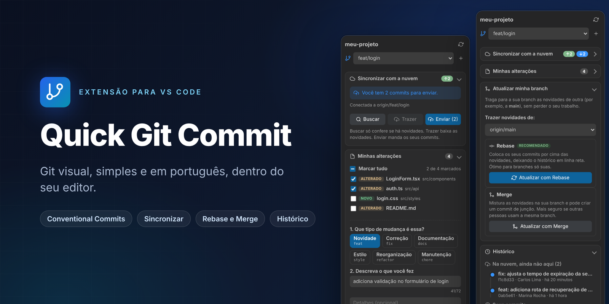
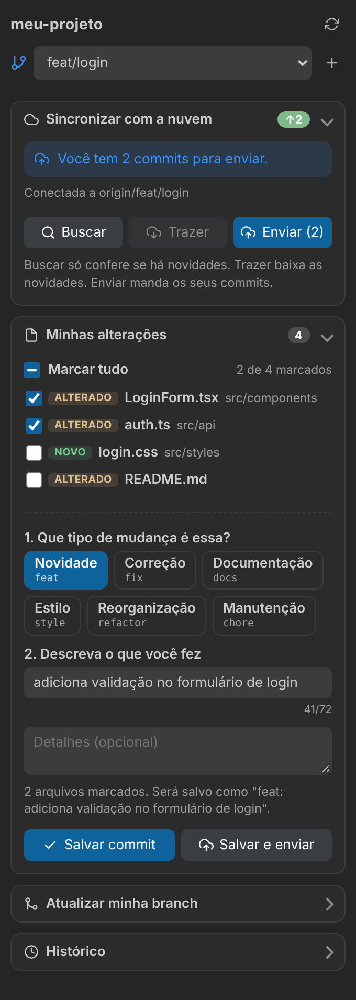
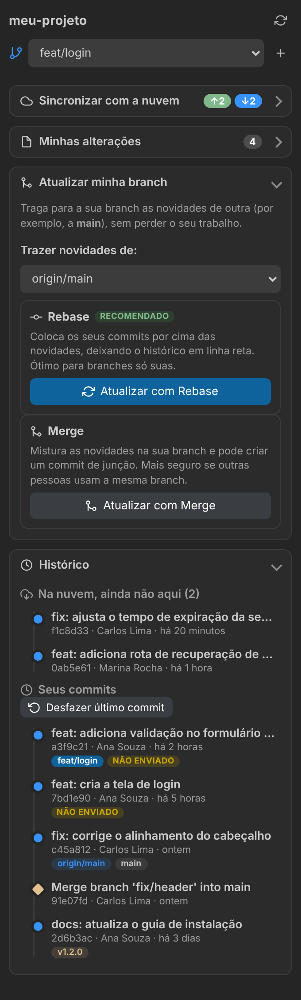
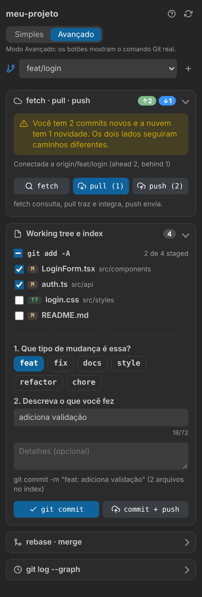
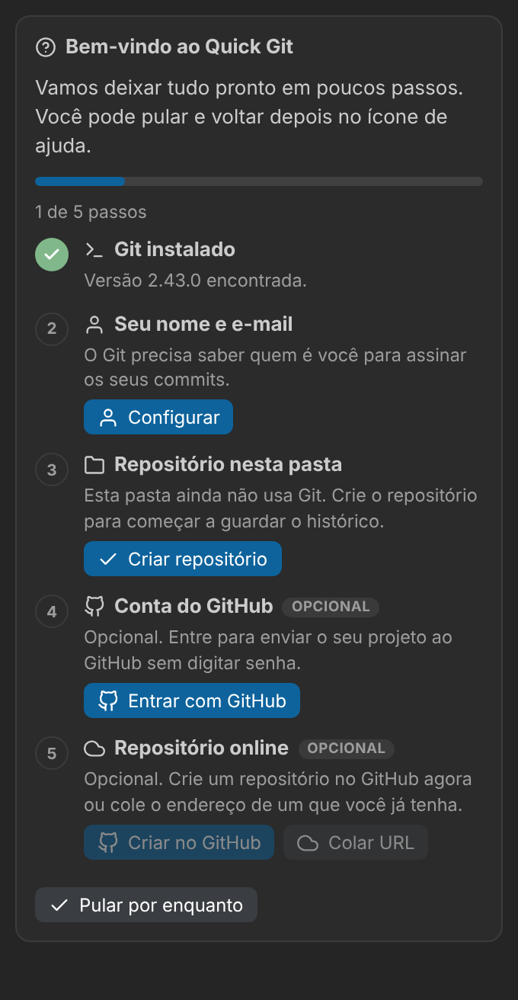
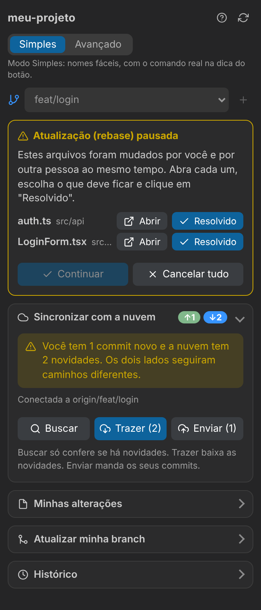

<p align="center">
  
</p>

<p align="center">
  <a href="https://github.com/GabrielMarcianoarante/quick-git-commit/releases"></a>
  
  
  <a href="LICENSE"></a>
  
</p>

<p align="center">
  <a href="#sobre">Sobre</a> ·
  <a href="#funcionalidades">Funcionalidades</a> ·
  <a href="#instalação">Instalação</a> ·
  <a href="#como-usar">Como usar</a> ·
  <a href="#roadmap">Roadmap</a> ·
  <a href="#contribuindo">Contribuindo</a>
</p>

---

## Sobre

**Quick Git Commit** é uma extensão para o Visual Studio Code que coloca o essencial do Git em um painel visual, em português, sem precisar digitar comandos no terminal.

Ela foi pensada para dois públicos ao mesmo tempo:

- **Quem está começando.** Cada ação usa linguagem simples ("trazer novidades da nuvem" em vez de `git pull`), explica o que vai acontecer e pede confirmação antes de qualquer coisa arriscada.
- **Quem já usa Git todos os dias.** Menos digitação, commits padronizados em poucos cliques e o estado do repositório sempre visível, sem sair do editor.

## Funcionalidades

### Painel Git na barra lateral

Tudo em um só lugar, com as cores do seu tema do VS Code.

<p align="center">
  
  &nbsp;&nbsp;
  
</p>

<p align="center"><sub>Capturas ilustrativas, geradas com dados de exemplo.</sub></p>

### Gráfico de branches e detalhes do commit

Cada linha colorida é uma branch. Os losangos marcam commits de junção (merge), e o anel destaca onde você está agora. Ao clicar em um commit, aparecem a mensagem, as estatísticas e os arquivos alterados.

### Modo Simples e Avançado

No modo **Simples**, os botões usam nomes fáceis e mostram o comando real na dica. No modo **Avançado**, o comando Git real fica em destaque, e os arquivos aparecem como no `git status` (`M`, `A`, `??`).

<p align="center">
  
  &nbsp;&nbsp;
  
</p>

### Guia inicial

Ao abrir o painel pela primeira vez, o guia leva você por cinco passos: Git instalado, nome e e-mail, repositório na pasta, conta do GitHub (opcional) e repositório online (opcional). Dá para pular e voltar depois pelo ícone de ajuda ou pelo comando **Quick Git: Abrir guia inicial**.

| Recurso | Descrição |
| --- | --- |
| **Sincronizar com a nuvem** | `Buscar` confere se há novidades, `Trazer` baixa as novidades e `Enviar` manda os seus commits. Contadores mostram quantos commits faltam em cada direção. |
| **Publicar e conectar** | Se a branch ainda não existe online, `Publicar na nuvem`. Se o projeto não tem repositório online, `Conectar à nuvem` pede a URL. |
| **Minhas alterações** | Lista de arquivos com caixas de seleção (marcado entra no commit), visualização do que mudou (diff) e opção de descartar. |
| **Commit padronizado** | Escolha o tipo, descreva a mudança e salve com `Salvar commit` ou `Salvar e enviar`. A mensagem é gravada no padrão Conventional Commits. |
| **Atualizar minha branch** | Traga as novidades da `main` (ou de qualquer branch) com **Rebase** ou **Merge**, cada um explicado em linguagem simples. |
| **Histórico com gráfico** | Linhas coloridas mostram branches, ramificações e junções (merge). Etiquetas de branches e tags, marcação de commits "não enviados" e "só na nuvem". |
| **Detalhes do commit** | Clique em um commit para ver a mensagem completa, quantos arquivos mudaram, as linhas adicionadas e removidas e a lista de arquivos. Clique em um arquivo para abrir a diferença. |
| **Modo Simples e Avançado** | Alterne no topo do painel entre nomes amigáveis e os comandos Git reais (`git fetch`, `git pull`, `git rebase`...). Boa forma de aprender Git usando. |
| **Guia inicial** | Na primeira execução, um passo a passo verifica o Git, configura nome e e-mail, cria o repositório, entra no GitHub e cria ou conecta o repositório online. |
| **Desfazer último commit** | Desfaz o commit mais recente (ainda não enviado) mantendo as suas alterações nos arquivos. |
| **Branches** | Trocar de branch e criar uma nova direto no topo do painel. |

### Resolução de conflitos guiada

Quando um rebase ou merge encontra conflitos, o painel lista os arquivos afetados e conduz o processo: `Abrir`, `Resolvido`, `Continuar` e `Cancelar tudo`. Cancelar sempre devolve a branch ao estado anterior, sem perder trabalho.

<p align="center">
  
</p>

### Commit rápido pela barra de status

O botão **Quick Commit** na barra inferior abre um fluxo guiado por menus, ideal para commits do dia a dia:

1. Escolha a branch: manter a atual, trocar para outra ou criar uma nova.
2. Selecione o prefixo do commit.
3. Digite a mensagem.
4. Escolha entre **Commit** e **Commit & Push**.

### Prefixos (Conventional Commits)

| Prefixo | Quando usar | Nome no painel |
| --- | --- | --- |
| `feat` | Nova funcionalidade | Novidade |
| `fix` | Correção de bug | Correção |
| `docs` | Mudanças na documentação | Documentação |
| `style` | Formatação, sem alterar a lógica | Estilo |
| `refactor` | Refatoração de código | Reorganização |
| `chore` | Tarefas de manutenção e build | Manutenção |

### Segurança

- Descartar alterações, rebase, merge, cancelar atualização, desfazer commit e envio forçado **sempre pedem confirmação**, explicando o efeito.
- O envio forçado usa `--force-with-lease`, que evita sobrescrever trabalho que você ainda não viu.
- O painel **nunca fica esperando senha no terminal**. Se faltar login, ele avisa o que fazer.
- Erros do Git são traduzidos para mensagens claras. Os detalhes técnicos ficam em **Ver > Saída > Quick Git Commit**.
- Os comandos `git` rodam localmente, via `execFile` com lista de argumentos (sem shell). A extensão não envia dados para nenhum serviço próprio. A única consulta de rede automática é a verificação de nova versão, uma requisição anônima à API pública de releases do GitHub (no máximo uma vez por dia), que não envia nenhuma informação sua e pode ser desativada.
- O login do GitHub usa o sistema de contas do próprio VS Code. O token fica com o VS Code, é entregue ao Git apenas em memória e somente para endereços `github.com`, e nunca é gravado em arquivos nem em logs.

## Requisitos

- [Git](https://git-scm.com/) instalado e acessível no PATH.
- Visual Studio Code 1.85 ou superior.
- Para `Trazer` e `Enviar`: login já configurado no Git (Git Credential Manager ou conta do GitHub no VS Code).

## Instalação

### A partir do código-fonte

```bash
git clone https://github.com/GabrielMarcianoarante/quick-git-commit.git
cd quick-git-commit
npm install
npm run compile
```

Abra a pasta no VS Code e pressione **F5** (configuração "Executar extensão"). Uma nova janela abrirá com a extensão carregada. Abra nela uma pasta que seja um repositório Git.

### Pelo GitHub Releases (recomendado)

1. Abra a página de [Releases](https://github.com/GabrielMarcianoarante/quick-git-commit/releases) e baixe o arquivo `quick-git-commit-X.Y.Z.vsix` da versão mais recente.
2. No VS Code, abra **Extensões**, clique em `...` (canto superior do painel) e escolha **Instalar de VSIX...**.
3. Selecione o arquivo baixado e recarregue o VS Code se ele pedir.

Também funciona pelo terminal: `code --install-extension quick-git-commit-X.Y.Z.vsix`.

**Atualizações:** quando sai uma versão nova, a extensão mostra um aviso com o botão **Baixar atualização**, que abre a página da release. Basta baixar o novo `.vsix` e instalar do mesmo jeito (ele substitui a versão antiga). A checagem acontece no máximo uma vez por dia e pode ser desligada em `quickGitCommit.checkForUpdates`. Para conferir na hora, use o comando **Quick Git: Verificar atualizações**.

### Gerando o .vsix você mesmo

```bash
npm install
npm run package
```

O arquivo `.vsix` é criado na raiz do projeto. Instale como no passo 2 acima.

## Como usar

1. Abra um projeto no VS Code e clique no ícone de branch na barra lateral esquerda.
2. Marque os arquivos que entram no commit, escolha o tipo e descreva a mudança.
3. Clique em `Salvar commit` ou `Salvar e enviar`.
4. Use a seção **Sincronizar com a nuvem** para trazer as novidades antes de enviar.
5. Precisa atualizar sua branch com a `main`? Abra **Atualizar minha branch** e escolha Rebase ou Merge.

Também é possível usar a Command Palette (`Ctrl+Shift+P`):

| Comando | Descrição |
| --- | --- |
| `Quick Git: Fazer commit rápido` | Abre o fluxo guiado de commit. |
| `Quick Git: Abrir painel` | Abre o painel Git na barra lateral. |
| `Quick Git: Atualizar painel` | Recarrega o estado do repositório. |
| `Quick Git: Abrir guia inicial` | Abre o passo a passo de configuração. |
| `Quick Git: Verificar atualizações` | Confere se existe uma versão mais nova no GitHub. |

## Atalhos e configurações

| Atalho (Mac: `Cmd`) | Ação |
| --- | --- |
| `Ctrl+Alt+G` `G` | Abrir o painel |
| `Ctrl+Alt+G` `C` | Commit rápido |
| `Ctrl+Alt+G` `F` / `L` / `P` | Buscar (fetch) / Trazer (pull) / Enviar (push) |
| `Ctrl+Alt+G` `S` | Marcar o arquivo aberto para o commit |

Clique com o botão direito em um arquivo (Explorer ou editor) para **Marcar arquivo para o commit**. No campo de mensagem do painel, `Enter` usa a ação padrão, `Ctrl+Enter` faz commit e envia, e `Shift+Enter` faz só o commit.

| Configuração | Padrão | O que faz |
| --- | --- | --- |
| `quickGitCommit.language` | `auto` | `auto`, `pt-BR` ou `en` |
| `quickGitCommit.commitTypes` | `feat`, `fix`, `docs`, `style`, `refactor`, `chore` | Prefixos (texto ou `{ "label", "description" }`) |
| `quickGitCommit.messageMaxLength` | `72` | Limite da mensagem, sem o prefixo (`0` = sem limite) |
| `quickGitCommit.askBranch` | `true` | Perguntar pela branch no commit rápido |
| `quickGitCommit.defaultAction` | `ask` | `ask`, `commit` ou `commitAndPush` |
| `quickGitCommit.checkForUpdates` | `true` | Avisar (no máximo 1 vez por dia) quando houver versão nova no GitHub |

Tudo isso também pode ser ajustado dentro do painel, na engrenagem no topo (idioma, prefixos, limite e ação padrão), sem abrir o `settings.json`.

## Roadmap

O objetivo é tornar o Quick Git Commit a forma mais fácil de usar Git dentro do VS Code. As prioridades abaixo podem mudar conforme o feedback da comunidade. Reaja com um polegar para cima nas issues das funções que você mais quer ver.

**Disponível**

- [x] Commit rápido pela barra de status (Conventional Commits)
- [x] Painel lateral visual
- [x] Buscar, Trazer e Enviar, com contadores de commits
- [x] Publicar branch e conectar repositório online
- [x] Marcar arquivos, ver diferenças e descartar alterações
- [x] Rebase e Merge com explicações em linguagem simples
- [x] Resolução de conflitos guiada
- [x] Histórico com novidades da nuvem e commits não enviados
- [x] Desfazer último commit mantendo as alterações
- [x] Trocar e criar branches
- [x] Guia inicial: Git, nome e e-mail, repositório, login no GitHub e criação do repositório online
- [x] Modo Simples e Avançado
- [x] Detalhes do commit: arquivos alterados e diferenças
- [x] Gráfico de branches com ramificações e junções
- [x] Aviso de nova versão com link para download

**Disponível na v0.3.0: experiência de uso**

- [x] Atalhos de teclado e ações no menu de contexto
- [x] Acessibilidade aprimorada (alto contraste e leitores de tela)
- [x] Internacionalização: inglês
- [x] Configurações da extensão: prefixos personalizados, limite de caracteres e comportamento padrão

**Próximo: mais idiomas**

- [ ] Espanhol e outros idiomas

**Em seguida: funções essenciais**

- [ ] Stash visual: guardar alterações temporariamente e recuperá-las depois
- [ ] Recuperação de commits e branches perdidos (reflog) com um clique
- [ ] Editar o último commit (amend): corrigir a mensagem ou incluir um arquivo esquecido
- [ ] Escopo no commit, como `feat(login): ...`, com sugestão de escopos
- [ ] Resolvedor de conflitos visual, comparando "suas mudanças" e "mudanças da nuvem"
- [ ] Reverter commit (revert) e cherry-pick com explicação simples
- [ ] Tags e releases: criar e enviar versões como `v1.0.0`
- [ ] Gerenciar branches: renomear, apagar e limpar as já mescladas
- [ ] Abrir Pull Request no GitHub e GitLab direto do painel
- [ ] Busca no histórico por mensagem, autor, arquivo ou data
- [ ] Sugestão opcional de mensagem de commit a partir das alterações
- [ ] Gitmoji opcional nos commits
- [ ] Aviso de arquivos sensíveis (`.env`, chaves) antes de commitar
- [ ] Gerador de `.gitignore` por tipo de projeto
- [ ] Suporte a vários repositórios e remotos
- [ ] Blame na linha: quem alterou a linha e quando
- [ ] Submódulos e commits assinados (GPG e SSH)

Tem uma ideia que não está na lista? [Abra uma issue](https://github.com/GabrielMarcianoarante/quick-git-commit/issues/new).

## Estrutura do projeto

```
quick-git-commit/
├── src/
│   ├── extension.ts     Ativação, comandos e botão da barra de status
│   ├── git.ts           Camada Git: execução segura e leitura de estado
│   ├── panel.ts         Painel lateral (webview) e ações
│   └── quickCommit.ts   Fluxo rápido de commit por menus
├── media/
│   ├── graph.js         Cálculo do gráfico de branches (função pura)
│   ├── main.js          Interface do painel
│   └── main.css         Estilos, baseados nas cores do tema do VS Code
├── resources/           Ícones da extensão
├── docs/images/         Imagens usadas neste README
└── package.json
```

A interface é uma webview com política de segurança de conteúdo (CSP) restrita, e os dados do repositório nunca são inseridos como HTML.

## Contribuindo

O projeto ainda **não aceita Pull Requests**. Estamos preparando o acordo de contribuição (CLA), e as contribuições de código abrirão assim que ele estiver pronto.

Enquanto isso, a sua ajuda é muito bem-vinda de outras formas:

- [Abra uma issue](https://github.com/GabrielMarcianoarante/quick-git-commit/issues/new) para relatar um problema ou sugerir uma função.
- Reaja com um polegar para cima nas issues que você mais quer ver.
- Compartilhe o projeto com quem sofre com Git.

Leia o [CONTRIBUTING.md](CONTRIBUTING.md) para mais detalhes.

## Licença

O Quick Git Commit é **gratuito para uso não comercial**, sob a licença [PolyForm Noncommercial 1.0.0](LICENSE). Você pode usar e modificar o código para uso pessoal, estudo, pesquisa e organizações sem fins lucrativos. Uso comercial, revenda e redistribuição com fins lucrativos não são permitidos sem autorização.

Pretendemos lançar no futuro uma versão **Pro**, com funções adicionais. Para licenciamento comercial, abra uma issue ou entre em contato com o autor.
